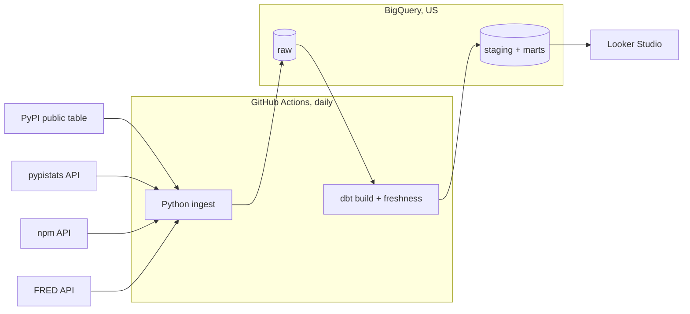

# AI SDK downloads

Which AI vendor are developers building on, and is it shifting?

This repo builds a daily answer from public download data: SDK downloads per vendor on PyPI and npm, cleaned of mirror and CI traffic, and reconciled against [pypistats.org](https://pypistats.org) before a number reaches the report.

**Status: week 3 of 5.** All 4 sources load and have staging models: 181 days of PyPI, 18 months of npm, every vintage of the Ramp AI Index. PyPI downloads are classified (vendor, mirror, CI). Marts, the recon model, the daily schedule and the report come next. See [Roadmap](#roadmap).

## What it measures

Headline metric: clean daily SDK downloads per vendor on PyPI. Side view: PyPI vs npm vs the [Ramp AI Index](https://fred.stlouisfed.org/series/RAMPAIALL), 3 signals that disagree, with the gap explained.

| Vendor | PyPI | npm |
|---|---|---|
| OpenAI | `openai` | `openai` |
| Anthropic | `anthropic` | `@anthropic-ai/sdk` |
| Google | `google-genai` + `google-generativeai` | `@google/genai` + `@google/generative-ai` |
| Stripe (control) | `stripe` | `stripe` |
| Twilio (control) | `twilio` | `twilio` |

- Google renamed its SDK, so both names count. With only the new name, Google's growth would look fake.
- Stripe and Twilio are a non-AI control group. If they grow at the same rate, the whole ecosystem grew (more CI, more developers), and no AI vendor gained ground.
- `openai` is also the generic client for OpenAI-compatible APIs, so its count runs high. Logs can't fix that. The report says so next to every OpenAI comparison.
- 1 download is 1 install, from a laptop, a CI job or a mirror. The metric tracks direction and share. It says nothing about user counts.

## How it works



- Ingest scripts copy source data into raw tables and hold no business logic. Which installers count as mirrors is a business rule, so it lives in dbt.
- dbt builds staging, intermediate, mart and recon models, and runs the tests.
- GitHub Actions will run everything daily at 07:17 UTC (week 4).
- Everything is in UTC.

## Findings so far

1. **My PyPI counts tie pypistats exactly on 165 of 181 days.** All 6 packages, 2026-05-24 to 2026-11-20, against pypistats `with_mirrors`.
2. **The other 16 days are all Monday to Thursday.** On each of them, all 6 packages are 0.6% to 7.2% above pypistats, never below. Working theory: pypistats counts each day 1 time, before the late rows land. Not proven yet.
3. **pypistats `without_mirrors` also drops downloads with no installer.** On 2026-11-18 for `anthropic`, it removed 62,501 downloads with a NULL installer and only 666 real mirror downloads.
4. **Mirrors barely matter. Missing installers and CI do.** Over 181 days: mirror installers are 0.006% of downloads, downloads with no installer 0.34%, CI 44.2%. The mirror rule in dbt reproduces pypistats `without_mirrors` on all 990 days where the totals tie.
5. **npm lost 6 days.** On 2026-09-15, 10-06, 10-14, 10-15, 10-19 and 10-20, npm reports 0 for all 6 packages, Stripe included. That's missing data, not a drop in usage. Staging turns those days into NULL, so 7-day averages and weekly shares don't dip.
6. **BigQuery's byte estimate ignores clustering inside a DML script.** The SELECT for 1 day estimates 1.6 GiB. The same SELECT inside a DELETE + INSERT script estimates 271 GiB, and the byte cap rejects it. So the PyPI load runs in 2 steps: a capped query into a load table, then delete and insert in 1 transaction.

## Cost guards

It runs on the BigQuery free tier (1 TiB of queries a month). The public PyPI table is huge: 1 day with no package filter scans 271 GiB.

- A custom quota of 30 GiB of queries a day on the project. This is the hard stop.
- `maximum_bytes_billed` on every ingest job, and 5 GiB per query in the dbt profile.
- A dry run before every ingest query. The script stops if the scan is over its cap.
- Only the PyPI ingest script reads the public table. dbt reads the raw copies.
- A $1 budget alert.

## Running it

```bash
python3.12 -m venv .venv
.venv/bin/pip install -r requirements.txt

.venv/bin/python -m ingest.pypi --start 2026-11-18 --end 2026-11-20 --max-gib 10
.venv/bin/python -m ingest.pypistats
.venv/bin/python -m ingest.npm
.venv/bin/python -m ingest.fred        # needs FRED_API_KEY in the environment or in .env
scripts/dbt build
scripts/dbt source freshness
```

Local runs check that gcloud is logged in as my personal account (`ingest/common.py`, `scripts/dbt`), and the profile points at my GCP project. A fork needs to change both.

## Repo layout

```
ingest/                   pypi.py, pypistats.py, npm.py, fred.py, common.py
dbt/models/staging/       1 view per source, sources + freshness
dbt/models/intermediate/  int_pypi__downloads_classified (vendor, mirror, CI flags)
dbt/seeds/                vendor_package_map.csv, pypi_mirror_installers.csv
dbt/tests/                singular tests
analysis/                 recon_check.sql (the 181-day recon), late_rows_check.sql
scripts/dbt               runs dbt with the personal gcloud token
```

## Data sources

- PyPI downloads: the public BigQuery dataset `bigquery-public-data.pypi.file_downloads`.
- [pypistats.org](https://pypistats.org) API, for the recon.
- npm downloads API.
- Ramp AI Index, via FRED. Copyright 2025–2026 Ramp Business Corporation. Citation required. Series: [RAMPAIALL](https://fred.stlouisfed.org/series/RAMPAIALL), [RAMPAIANTHROPIC](https://fred.stlouisfed.org/series/RAMPAIANTHROPIC), [RAMPAIOPENAI](https://fred.stlouisfed.org/series/RAMPAIOPENAI), [RAMPAIXAI](https://fred.stlouisfed.org/series/RAMPAIXAI).

This product uses the FRED® API but is not endorsed or certified by the Federal Reserve Bank of St. Louis. [FRED API terms of use](https://fred.stlouisfed.org/docs/api/terms_of_use.html).

## Roadmap

- [x] Week 0: go / no-go checks. Cost dry run, 1 day of pypistats reproduced by hand in SQL.
- [x] Week 1: PyPI and pypistats ingestion, 181-day backfill, dbt project, staging models, source freshness.
- [ ] Week 2: mirror, CI and vendor classification. Recon model and tolerance. Bug write-up.
- [ ] Week 3: npm and FRED ingestion. Vendor daily, weekly share and triangulation marts.
- [ ] Week 4: daily GitHub Actions run, run log, Looker Studio page with a trust tile.
- [ ] Week 5: decision log, bug story, live report link.
